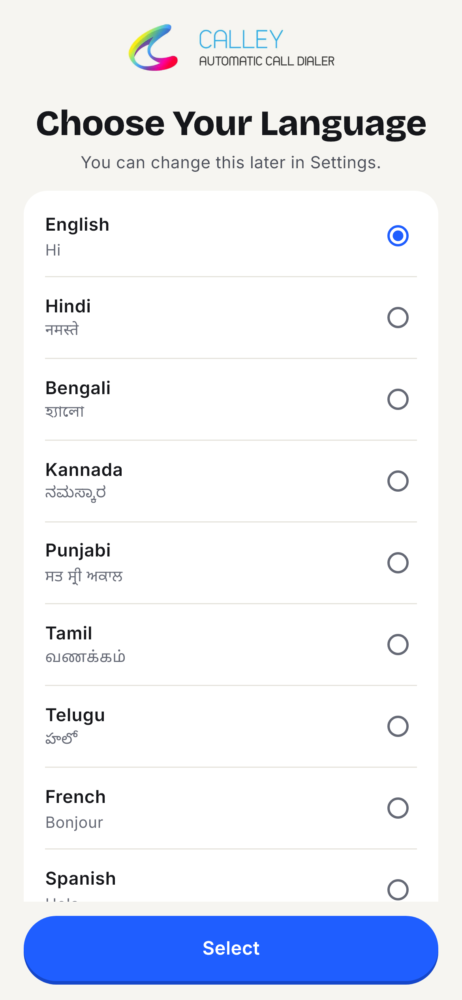
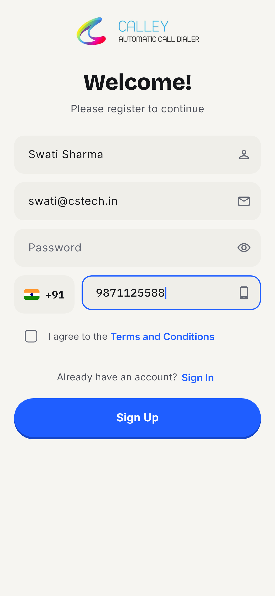
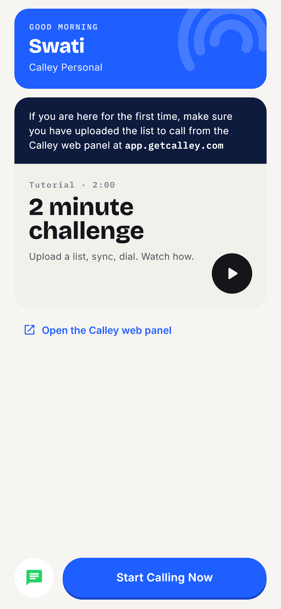
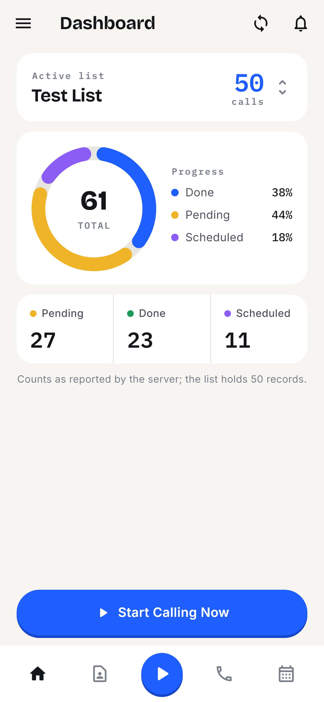
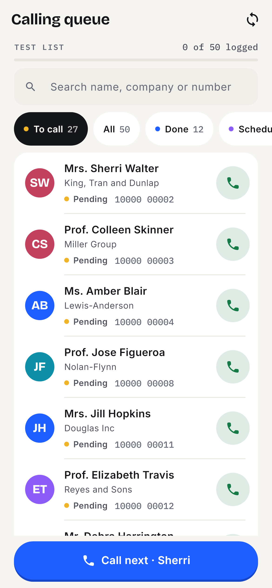
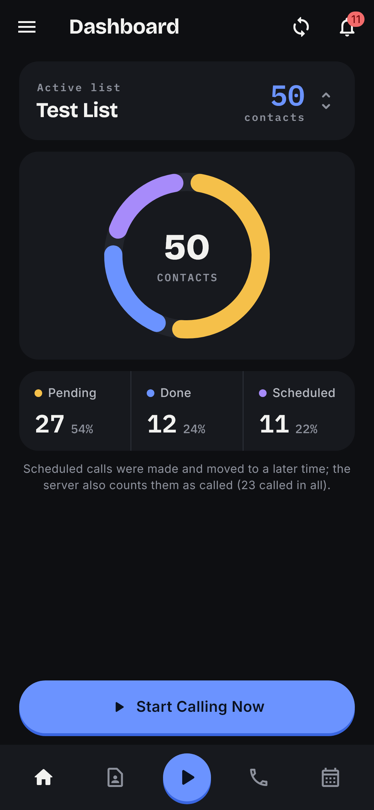
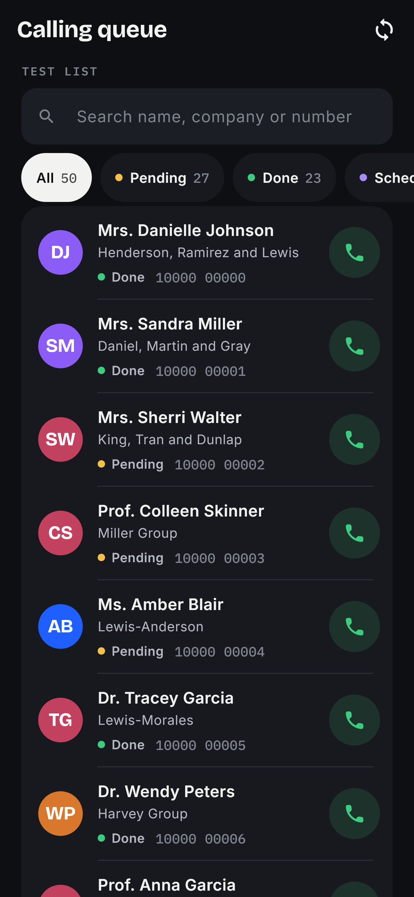
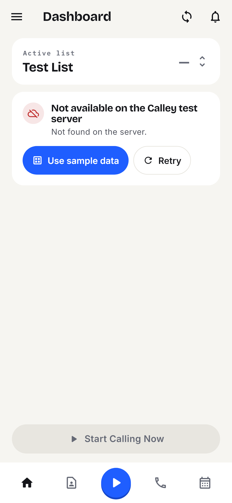
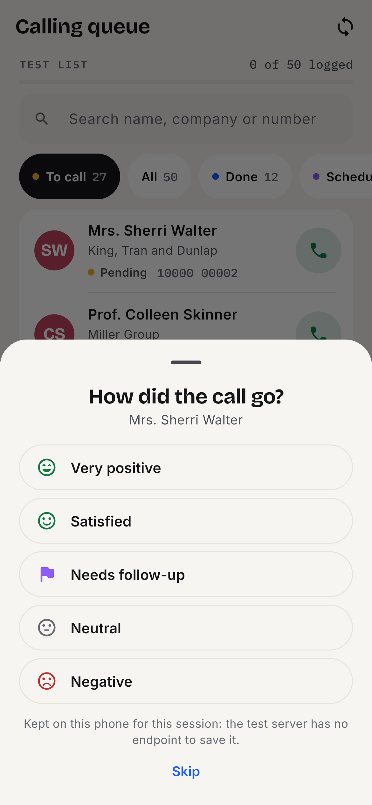
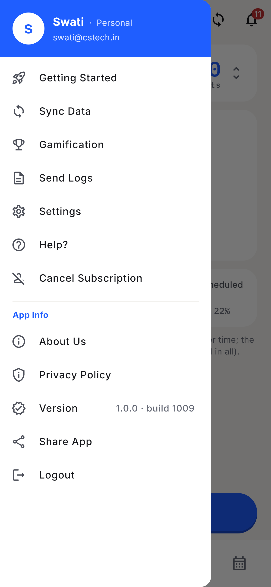

# Calley — automatic call dialer (Flutter)

A Flutter build of the Calley mobile app's first ten screens, made for the C S Tech Infosolutions Flutter machine test. Nine screens follow the Figma file; the tenth, the calling queue, is what "Start Calling Now" leads to.

<p>
  
  
  
  
  
</p>
<p>
  
  
  
  
  
</p>

Every screen, light and dark, is in [`snapshots/`](snapshots/). They are rendered by `flutter test test/snapshots` at 390×844 @3x with the app's bundled fonts, so they are the real widget tree, not mock-ups.

## Why the app uses demo data

**The API supplied for this test is not reachable, so the app ships with a demo mode.** Everything else is built against the real API.

- The test points to the Postman collection [Mock API V2](https://documenter.getpostman.com/view/38199901/2sB34Zpiy9), at `https://mock-api.calleyacd.com/api`. A copy is kept in [`MD/assets/postman-mock-api-v2.json`](../MD/assets/postman-mock-api-v2.json).
- When checked on 2026-11-04 and again on 2026-11-05, **every documented endpoint returned HTTP 404** with an empty body: register, login, send-otp, verify-otp, list and list details.
- The server's TLS certificate is issued to the hosting provider's name (`cool-meninsky.74-208-123-142.plesk.page`), not to `mock-api.calleyacd.com`, so browsers and Postman refuse the connection.
- The root URL shows the hosting provider's default page. Together this suggests the domain is still parked on the hosting server but the API app is not deployed there.
- You can check this yourself: <https://mock-api.calleyacd.com/api/list?userId=68626f9497757cb741f449b0>.

**What the app does about it:**

1. **It calls the real API first.** Requests, bodies and response parsing follow the Postman collection exactly, including login's `{"user": {...}}` wrapper and `GET /list` returning a single object. TLS is not switched off: the app trusts only that one server's certificate.
2. **When a call fails, it says why.** For example: *"Not available on the Calley test server"*, with **Retry** and **Use sample data**. It never shows a fake success.
3. **Sample data is the collection's own examples.** The "Test List" and its 50 contacts in `assets/mock/` are copied from the Postman example responses, so every list screen shows what the real API would return. The signed-in user is Swati, the person in the Figma screens.
4. **A banner stays on every screen while sample data is on.** It cannot be mistaken for live data, and **Try server** switches back.
5. **The demo login** below goes straight to sample mode, so the whole flow can be tested in one tap.

**If the API comes back or moves:** nothing needs rebuilding for the same host. A new address is one build setting: `flutter run --dart-define=API_BASE_URL=https://new-host/api`. If the new server presents a different certificate, its SHA-256 fingerprint is added in `lib/core/network/api_client.dart`.

## Demo login

| Email | Password |
|---|---|
| `demo@getcalley.com` | `Demo@1234` |

The login screen shows these, with a one-tap **Sign in with the demo account** button. Any other email goes to the real API.

## Run

```
flutter pub get
flutter run                                   # a device or emulator
flutter build apk --debug                     # build/app/outputs/flutter-apk/app-debug.apk
flutter run --dart-define=USE_MOCK=true       # force sample data (no server at all)
```

Requires Flutter 3.35+ (built with 3.47 / Dart 3.13). Android `minSdk` is Flutter's default (21).

## What it does

| Screen | Figma | Behaviour |
|---|---|---|
| Choose language | 01 | Nine languages with native greetings; remembered; reachable again from Settings |
| Register | 02 | Name, email, password, +91 mobile, T&C; validates before sending; `POST /auth/register` then `POST /auth/send-otp` |
| OTP | 03 | Six boxes that paste, auto-advance and backspace; resend with a 30 s timer; `POST /auth/verify-otp` |
| Login | 04 | `POST /auth/login`; session persisted; wrong password clears the field |
| Getting started | 05 | Greeting, the web-panel note, the tutorial card (opens YouTube), WhatsApp, Start Calling Now |
| Dashboard, no list | 06 | "Load number to call" or "Choose a calling list"; `GET /list?userId=` |
| Calling lists | 07 | Bottom sheet and Settings section with Refresh; selection persisted |
| Dashboard, active list | 08 | `GET /list/{id}`: ring chart, Pending/Done/Scheduled ledger, counts as the server sends them |
| Drawer | 09 | All items; Logout clears the session and returns to Login |
| Calling queue | — | Search and status filters, one tap opens the dialer, then a disposition sheet (kept for the session: the API has no write endpoint) |

Pull to refresh on every data screen. Light and dark themes (Settings → Appearance).

## Architecture

```
lib/
  app/        router (go_router, session gate), theme (tokens, three bundled fonts)
  core/       network (dio client + pinned cert, CalleyApi: remote and sample)
              storage (shared_preferences), providers (Riverpod), widgets, utils
  models/     User, CallingList, ListDetails, CallRecord — fromJson only, nothing invented
  features/   language, auth, onboarding, dashboard, lists, calls, settings, drawer
assets/       fonts (Inter, Bricolage Grotesque, IBM Plex Mono — OFL), mock JSON
test/         snapshot harness and tests
```

- **State:** Riverpod 3. Preferences the user set (language, theme, selected list, data source, session) live above every screen and survive navigation; transient state stays local.
- **Networking:** `dio`, 10 s timeouts, plain-language errors, no automatic retry (the Retry button is explicit).
- **Design:** warm paper background; Bricolage Grotesque for headings and the one hero number per screen, IBM Plex Mono (tabular) for every figure, Inter for body. Status is always a word with a dot, never colour alone. 48 px hit targets. Reduced motion respected.

## Checks

```
flutter analyze                                 # 0 issues
flutter test                                    # 32 snapshot tests: every screen builds, light and dark
flutter test test/snapshots --update-goldens    # regenerate snapshots/ after a deliberate UI change
```

## Known limits

- The server's counts overlap (the 11 rescheduled calls are also among the 23 called). The app shows disjoint groups that add up to the 50 records and says so under the ledger.
- The Figma has "Star Calling Now"; the app says "Start Calling Now".
- The 2-minute-challenge thumbnail and the "load number" illustration are drawn, not the Figma images (which could not be exported from a view-only file).
- No iOS build was made (no Mac); the iOS project is generated and `url_launcher` schemes are not yet declared in `Info.plist`.
